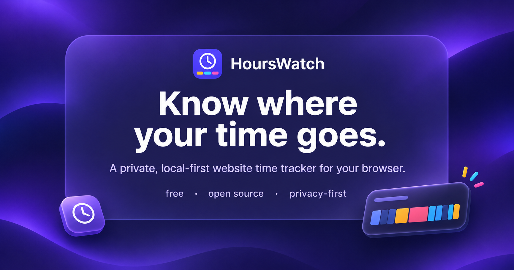
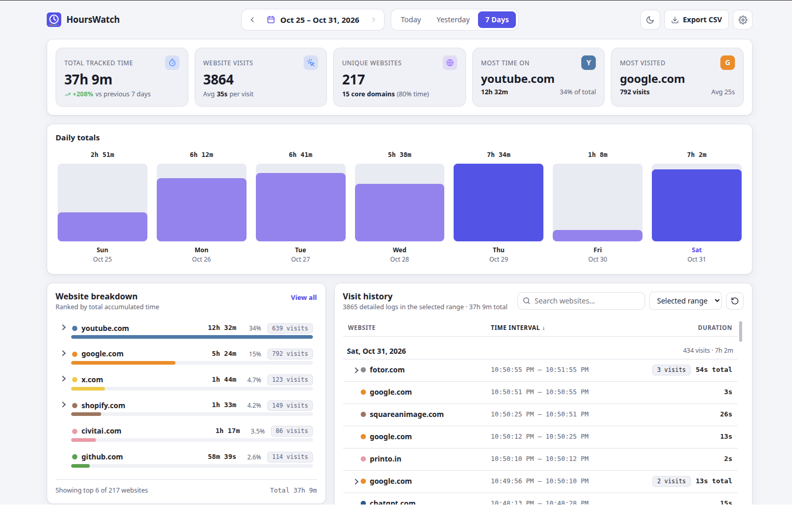
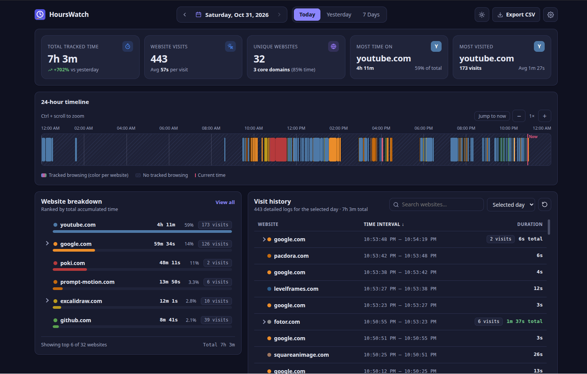
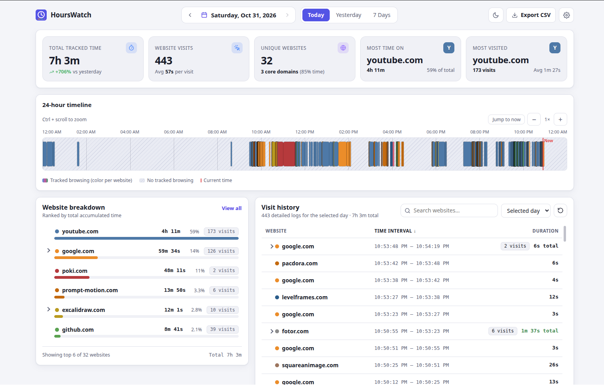

<div align="center">


<h1>
  HoursWatch
</h1>

**See where your browsing time actually goes. Privately.**

A Chrome extension that tracks the websites you actively look at and shows them as a 24-hour timeline, with daily stats, searchable history and CSV export. Everything stays on your computer.


</div>

---
<p align="center">
  
</p>
<p align="center">
  <a href="https://chromewebstore.google.com/detail/hourswatch/gdefppecgcgglgjioapijkanckicjjck">
      <picture>
        <source srcset="https://i.imgur.com/XBIE9pk.png" media="(prefers-color-scheme: dark)">
        
      </picture>
  </a>
</p>


## Features

- **24-hour timeline**: one block per visit, placed by its real start and end time. Zoom, hover, click for details.
- **Any date range**: Today, Yesterday, 7 Days, or a custom range from a calendar. Ranges show a daily-totals chart and a trend against the previous period.
- **Website breakdown**: time, share and visits per site, with subdomains grouped under their website (expand to see each one).
- **Visit history**: search, sort, and back-to-back visits folded into one row.
- **Only real, active time**: counts while Chrome is focused, the site is the active tab, and you are at your computer. Locking the screen or walking away stops the clock.
- **Toolbar popup**: current status, today's total, top sites, and a Pause/Resume button.
- **CSV export** for a day, a range, or all history.
- **Light and dark themes**, 12/24-hour time, never-track list.

## Screenshots

<div style="display: flex; gap: 20px;">
  
  
  
</div>


## Privacy

HoursWatch is built so your data cannot leave your machine.

- Stores only the **domain** (e.g. `github.com`) and the start, end and duration of each visit.
- Never stores URLs, page titles, page content, form data, passwords or cookies. Never runs in incognito.
- **No network access**: no server, no account, no analytics. There are no content scripts and no host permissions.
- Pause with one switch, or delete everything in Settings.

Read the full [Privacy Policy](PRIVACY.md).

## Install

### From source (load unpacked)

Requires Node 20+ and Chrome 116+.

```bash
git clone https://github.com/azeezv/HoursWatch.git
cd HoursWatch
npm install
npm run build          # writes the extension to dist/chrome
```

Then in Chrome:

1. Open `chrome://extensions`.
2. Turn on **Developer mode** (top-right toggle).
3. Click **Load unpacked** and select the **`dist/chrome`** folder (the one containing `manifest.json`).
4. Click the puzzle-piece icon in the toolbar and **pin HoursWatch**.

Tracking starts immediately. After changing the code, run `npm run build` again and press the reload icon on the extension's card.

### Development

```bash
npm run dev            # builds, opens Chrome with the extension, reloads on change
npm test               # unit tests (Vitest)
npm run typecheck
```

> Don't run `npm run dev` and `npm run build` at the same time: both write to `dist/chrome`.

## Permissions

| Permission | Why it is needed |
| --- | --- |
| `tabs` | Read the **URL of the active tab** so its domain can be recorded and eligibility decided. Without it Chrome hides `tab.url`. Only the hostname is ever stored. |
| `storage` | Save visits and settings in `chrome.storage.local`. |
| `unlimitedStorage` | Local storage is capped at 10 MB, which heavy browsing (tens of thousands of visits) can exceed. Without this, recording would silently start failing. |
| `idle` | Ask Chrome whether you are `active`, `idle` or `locked`, so time you spent away from the computer isn't counted. Only that state is read, never what you do. |
| `alarms` | A one-minute heartbeat that wakes the service worker if Chrome suspended it, so an open visit is re-verified and checkpointed. It never counts time. |

No host permissions, no content scripts, no `webNavigation`, no `history`, no network access. Navigation is detected through `tabs.onUpdated`, which also reports single-page-app URL changes, so `webNavigation` isn't needed.

## Documentation

<details>
<summary><b>Using the extension</b></summary>

- **Toolbar icon**: a popup with the current status (tracking / paused), today's total, a mini 24-hour strip, your top sites, a **Pause/Resume** button and **Open dashboard**.
- **Dashboard** (opens in a tab; also reachable from `chrome://extensions` → HoursWatch → *Extension options*):
  - **Header**: previous/next arrows, a date picker, quick **Today / Yesterday / 7 Days** buttons, a light/dark toggle, *Export CSV* and *Settings*. Click the date to open a calendar: pick one day, or click a first and a last day to select a **range** (click the same day twice for a single day). It also has presets (last 7 days, last 30 days, this month, all time). The arrows move by the length of the current selection.
  - **Ranges** (two or more days): the summary, website breakdown and history cover the whole range, the summary compares with the same number of days just before it, and the 24-hour timeline is replaced by a bar for each day's total (scrolls sideways for long ranges). Click a bar to open that day. *Export CSV* opens with the range preselected.
  - **Summary**: total tracked time with the change vs yesterday (today is compared with yesterday up to the same time of day), visits and average visit, unique websites with how many "core" sites make up ~80% of your time, most time on and most visited.
  - **24-hour timeline**: one colored block per visit, positioned and sized by real start/end time. Hatched areas are time with no tracked browsing; a red line marks *now* (today only). Hover a block for details, click it for the visit panel. Zoom with **+/−** or **Ctrl + scroll**, scroll sideways when zoomed, **Jump to now**. Visits crossing midnight are split across both days.
  - **Website breakdown**: your top 6 websites with time, share and visit count (**View all** lists every site), and the day's total. Click a site to filter the history and timeline; click the arrow to see its subdomains.
  - **Visit history**: search by website; scope = the selected day or range / all history; click the column titles to sort by website, time or duration (click again to reverse); the reset button clears filters. Back-to-back visits to the same website fold into one expandable row ("4 visits · 19s total"), and visits of a minute or longer are highlighted.
  - **Export CSV**: selected day, custom range, or all history (see below).
  - **Settings**: theme, 12/24-hour time, subdomain grouping, pause tracking, away detection and threshold, ignore very short visits, never-track list, privacy summary, **delete all data**.

### CSV export

Columns: `Date, Website Domain, Visit Start Time, Visit End Time, Duration in Seconds, Duration (Human-Readable)`.
Times are local (`YYYY-MM-DD HH:mm:ss`). A visit crossing midnight is exported as one row per day, each with that day's share of the duration. Files are UTF-8 with a BOM so Excel opens them correctly, values are RFC 4180-escaped, and cells that look like spreadsheet formulas are neutralised. Filenames: `hourswatch-2025-06-10.csv`, `hourswatch-2025-06-01_to_2025-06-10.csv`, `hourswatch-all-history-2025-06-10.csv`. Files are generated in the page; nothing is uploaded.

</details>

<details>
<summary><b>What counts as tracked time</b></summary>

Time accrues only while **both** are true: the Chrome window is focused, **and** the site is the active tab of that window.

It pauses immediately when you switch tabs, switch to another app, lose window focus, navigate to an unsupported page, close the tab, or **lock your screen**. It resumes when Chrome is focused again on an eligible tab.

**Away detection.** A third condition is that you are at the computer. If there is no keyboard or mouse input for **5 minutes** (configurable in Settings, or switch it off), you count as away. The visit is then ended at the moment of your *last input*, not when the 5 minutes ran out, so the waiting time is not counted. When you touch the computer again, a new visit starts immediately. Caveat: watching a video without touching the mouse can look like being away; raise the threshold or turn the feature off if that matters to you.

- Only `http(s)` pages are tracked. `chrome://`, extension pages (including this dashboard), `file:`, `about:`, `data:`, `view-source:` and the Chrome Web Store are ignored.
- Incognito is never tracked (the extension is not allowed in incognito).
- Each visit is recorded with its exact hostname, minus a leading `www.` (`www.github.com` = `github.com`). Switching between two subdomains (`mail.google.com` → `docs.google.com`) ends one visit and starts another.
- **Grouping.** By default the dashboard and popup group subdomains under their website: `mail.google.com`, `docs.google.com` and `google.com` all count as **google.com**, and country suffixes are understood (`news.bbc.co.uk` → `bbc.co.uk`). In the website breakdown, click the arrow next to a site to expand it into its hostnames with time, share and visits. The exact hostname is also shown in the visit panel, tooltip and history rows. Hosting platforms where each subdomain is a different site (`alice.github.io`) are kept apart. Turn grouping off in Settings to see every hostname separately. Nothing is lost either way, because grouping is applied only when displaying. CSV exports always list the exact hostname.
- Navigating within one domain (links, SPA route changes, switching between two tabs of the same site) continues the same visit. Switching domains closes it and starts a new one.
- Visits shorter than 1 second (configurable) are dropped, so flicking through tabs doesn't create noise.

</details>

<details>
<summary><b>How it works (architecture)</b></summary>

```text
src/
  background/   service worker: events -> TrackingEngine (the state machine)
    engine.ts     reconciles persisted session with the real browser state
    chrome-env.ts reads focused window / active tab from chrome.*
    index.ts      event wiring, 1-minute heartbeat, focus verification
  storage/      KeyValueStore abstraction, date-bucketed visit repo, migrations
  shared/       time/day-splitting, domain rules, stats, CSV (pure, unit-tested)
  dashboard/    full-page UI (timeline, summary, breakdown, history, dialogs)
  popup/        toolbar popup
tests/          Vitest unit tests
```

**State machine.** Every relevant event (tab activated/created/closed/updated, window focus/removal, startup, alarm) calls `engine.sync(at)`. `sync` asks Chrome what is true *now*, then reconciles: close the open visit if the target changed or disappeared, checkpoint it if unchanged, open one if a new eligible tab appeared. Calls are serialised, and the visit and tracker state are written in a single atomic `storage.local.set`.

**Time source.** Visits store absolute epoch-ms `startTime`/`endTime`; durations are derived from timestamps. No timer is ever used to *count* time, so service-worker suspension cannot skew it.

**Focus verification.** Chrome does not reliably fire `windows.onFocusChanged` when focus moves to another *application* (observed on Linux; it does fire when focus returns). So while a visit is open the worker re-verifies eligibility every second. This only detects changes quickly; it adds no time itself, and it stops as soon as nothing is being tracked. Persisted checkpoints from this loop are throttled to once per 15 s.

**Recovery.** The persisted checkpoint is the last moment eligibility was verified. If the next sync finds it more than 150 s old (worker killed, laptop asleep, crash), the visit is closed *at the checkpoint* and the gap is not counted. On a browser restart or extension reload (detected through `storage.session`, which is cleared by both) any leftover visit is closed at its checkpoint, even after a quick restart. If Chrome's APIs fail, the visit stops at the last verified moment.

**Storage.** `visits:YYYY-MM-DD` buckets (keyed by the UTC date of the start time, so timezone/DST changes never move records), plus `visitIndex`, `tracker`, `settings`, `domainColors`, and `schemaVersion` with a migration runner (`src/storage/migrations.ts`). Queries read only the buckets that overlap the requested range.

**Midnight and DST.** Visits are stored whole and split at **local** midnight when reporting/rendering. Days are computed with calendar arithmetic, so 23- and 25-hour DST days are correct; the timeline axis uses the day's real length.

</details>

<details>
<summary><b>Tests</b></summary>

`npm test` runs 141 tests covering tab switching, window-focus changes (including focus loss with no event), idle and locked-screen handling, same/cross-domain navigation, ineligible pages, incognito, pause and exclusions, service-worker restart and gap recovery, browser restart, clock skew, midnight and DST boundaries, duration/stat calculations, storage persistence and migrations, colors, and CSV output.

</details>

<details>
<summary><b>Known limitations</b></summary>

- **Passive viewing can look like being away.** Chrome only counts keyboard and mouse input, so watching a long video without touching anything is treated as idle after the threshold (default 5 minutes). Raise the threshold or switch away-detection off in Settings.
- A crash or power loss can lose up to ~15 s at the end of the last visit (the throttled checkpoint), never more.
- Grouping uses a built-in approximation of the Public Suffix List (country second-level suffixes such as `co.uk`, plus common hosting platforms), not the full list, so an unusual suffix may group at the wrong level. Turn grouping off to see raw hostnames.
- Domains are stored as Chrome reports them (IDN hostnames appear in punycode).
- Per-visit records only: there is no per-page or per-title breakdown, by design.

</details>

## Contributing and support

Bug reports, ideas and pull requests are welcome.

- **Bugs and feature requests**: [open an issue](https://github.com/azeezv/HoursWatch/issues). **Feedback or questions**: email [hello@azeezv.me](mailto:hello@azeezv.me).
- **Pull requests**: run `npm run typecheck && npm test` first, and keep changes focused. Commit subjects use `feat:`, `fix:` or `chore:`.

## License

[MIT](package.json). Built with TypeScript, Manifest V3 and [Extension.js](https://extension.js.org), with no UI framework.
